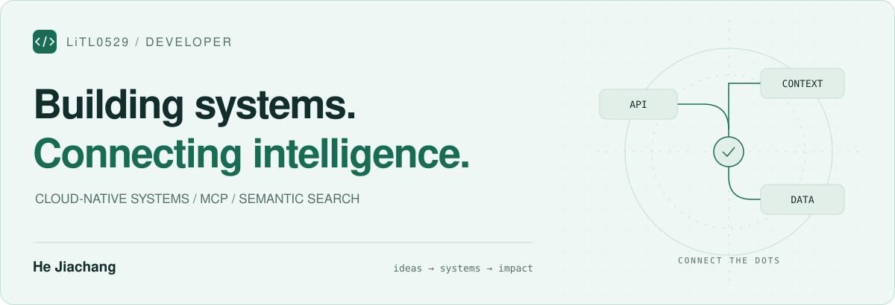

<picture>
  <source media="(prefers-color-scheme: dark)" srcset="assets/hero-dark.svg">
  <source media="(prefers-color-scheme: light)" srcset="assets/hero-light.svg">
  
</picture>

  <a href="https://github.com/LiTL0529?tab=repositories">Explore repositories ↗</a>
  &nbsp; · &nbsp;
  <a href="https://github.com/LiTL0529/team9-booking-platform">Booking platform</a>
  &nbsp; · &nbsp;
  <a href="https://github.com/LiTL0529/MCP">MCP insight hub</a>

### Hi, I'm Jiachang 👋

我在这里记录软件系统与 AI 应用的实践：从云原生预约平台，到通过 MCP 连接的语义检索服务。

I build and explore cloud-native systems and AI integrations, with an interest in how services scale, communicate, and turn data into useful experiences.

### Selected work / 项目精选

| Project | What’s inside |
| :--- | :--- |
| **[01 · Multi-Merchant Booking Platform ↗](https://github.com/LiTL0529/team9-booking-platform)** | 多商户预约平台 · Team 9 团队项目（NUS-ISS SE34FT）。五个可独立扩展的 FastAPI 微服务，覆盖商户、资源目录、可用性、预约与通知。  `Python` `FastAPI` `AWS ECS Fargate` `Terraform` |
| **[02 · JA Insight Hub ↗](https://github.com/LiTL0529/MCP)** | 基于 MCP 的洞察检索服务。使用 Supabase / pgvector 检索双语报告，将图片描述纳入语义搜索，并按用户权限控制访问。  `TypeScript` `MCP` `Supabase` `pgvector` |

### In the toolbox / 项目技术栈

**Build** &nbsp; Python · TypeScript · FastAPI · React  
**Data** &nbsp; PostgreSQL · Redis · Supabase · pgvector  
**Ship** &nbsp; AWS · Docker · Terraform · GitHub Actions

### What connects the dots / 关注方向

- **Systems** — 微服务边界、事件驱动通信与可扩展架构。
- **Intelligence** — MCP 集成、语义检索与多模态数据的连接。
- **Practice** — 把架构设计落到可运行、可测试、可部署的项目中。

---

  从一个想法，到一个可以运行的系统。 Ideas → systems → something useful.

